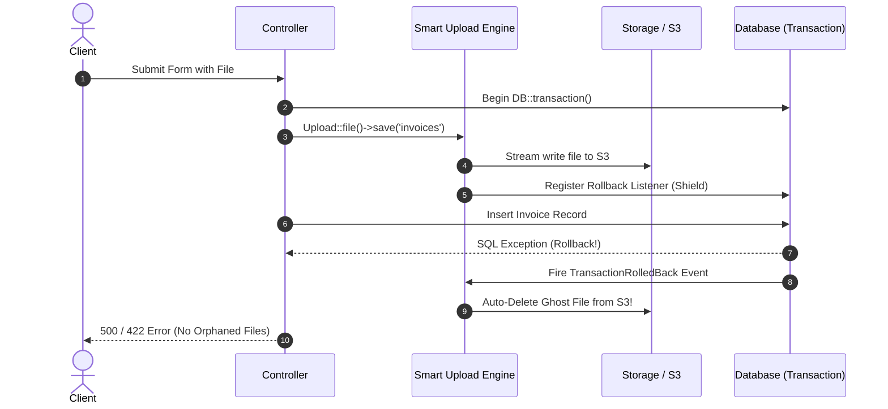
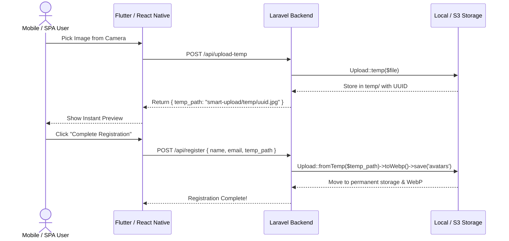

# Laravel Smart Upload

[](https://github.com/kaziomarsh24/laravel-smart-upload/actions)
[](https://packagist.org/packages/thekaziomar/laravel-smart-upload)
[](https://packagist.org/packages/thekaziomar/laravel-smart-upload)
[](https://php.net)
[](https://laravel.com)
[](LICENSE.md)

> ### Developer-First, Zero-Database File & Chunk Upload Engine for Laravel
> Eliminates heavy database migrations and media tables, brings fluent order-independent method chaining, auto-converts images to WebP with responsive downscaling (`scaleDown`) and center-cropping (`fit`), prevents orphaned "ghost files" on S3 during database rollbacks (`DB::transaction`), streams large video chunks with zero memory bloat, and auto-purges old files upon Eloquent model updates.

```php
use App\Models\User;
use KaziOmar\SmartUpload\Facades\Upload;

// 1. Fluent One-Liner: Auto-WebP, downscaled, S3-routed, and replaces previous avatar on disk
$result = Upload::file($request->file('avatar'))
    ->replace($user->avatar)
    ->preset('avatar')
    ->save('avatars');

$user->update(['avatar' => $result->path]);

// 2. Large Video Resumable Chunk Upload: Stream-merges parts with zero RAM spike
$chunk = Upload::chunk($request);
if ($chunk->isComplete()) {
    $video = $chunk->save('videos'); // Done!
}
```

---

## Table of Contents

- [Why Laravel Smart Upload?](#why-laravel-smart-upload)
- [Requirements & Installation](#requirements--installation)
- [Quickstart in 10 Seconds](#quickstart-in-10-seconds)
- [Architectural Philosophy](#architectural-philosophy)
- [Layer 1: The Fluent Upload Engine (`Upload::`)](#layer-1-the-fluent-upload-engine-upload)
  - [1.1 Single Image Upload (WebP & Compression)](#11-single-image-upload-webp--compression)
  - [1.2 Smart Image Sizing (`scaleDown` vs `fit`)](#12-smart-image-sizing-scaledown-vs-fit)
  - [1.3 Order-Independent Fluent Chaining](#13-order-independent-fluent-chaining)
  - [1.4 Batch Uploads (`Upload::files`) & `UploadCollection`](#14-batch-uploads-uploadfiles--uploadcollection)
  - [1.5 Raw Non-Image File Handling](#15-raw-non-image-file-handling)
  - [1.6 Old File Replacement (`->replace()`)](#16-old-file-replacement--replace)
  - [1.7 Named Presets (`->preset()`)](#17-named-presets--preset)
  - [1.8 Multi-Disk Routing (Local, S3, R2, Spaces)](#18-multi-disk-routing-local-s3-r2-spaces)
- [Layer 2: Strict Security & Defense-in-Depth Shield](#layer-2-strict-security--defense-in-depth-shield)
  - [2.1 Real MIME Magic-Bytes Inspection](#21-real-mime-magic-bytes-inspection)
  - [2.2 Anti-Path Traversal & Null-Byte Protection](#22-anti-path-traversal--null-byte-protection)
  - [2.3 Multi-Extension Spoofing Guard (`.php.jpg`)](#23-multi-extension-spoofing-guard-phpjpg)
  - [2.4 SVG XSS Sanitization](#24-svg-xss-sanitization)
  - [2.5 EXIF & Geolocation Metadata Stripping](#25-exif--geolocation-metadata-stripping)
  - [2.6 Cryptographic Entropy & Safe Slug Naming](#26-cryptographic-entropy--safe-slug-naming)
- [Layer 3: Atomic Database Rollback Shield (Ghost File Protection)](#layer-3-atomic-database-rollback-shield-ghost-file-protection)
  - [3.1 The Ghost File Problem in Cloud Storage](#31-the-ghost-file-problem-in-cloud-storage)
  - [3.2 Automatic Transaction Level Detection](#32-automatic-transaction-level-detection)
  - [3.3 Transaction Rollback Workflow](#33-transaction-rollback-workflow)
- [Layer 4: Resumable Chunk Upload Engine (Large Files & Videos)](#layer-4-resumable-chunk-upload-engine-large-files--videos)
  - [4.1 Low-Memory Sequential Stream Merging](#41-low-memory-sequential-stream-merging)
  - [4.2 Client-Agnostic Parameter Support (Dropzone, Resumable.js, Uppy)](#42-client-agnostic-parameter-support-dropzone-resumablejs-uppy)
  - [4.3 Incomplete Upload Safeguards](#43-incomplete-upload-safeguards)
- [Layer 5: Mobile & SPA Two-Step Upload Engine](#layer-5-mobile--spa-two-step-upload-engine)
  - [5.1 Direct Multipart vs Two-Step Uploads](#51-direct-multipart-vs-two-step-uploads)
  - [5.2 Livewire, React, Flutter & React Native Workflows](#52-livewire-react-flutter--react-native-workflows)
  - [5.3 Temporary Storage (`Upload::temp()`)](#53-temporary-storage-uploadtemp)
  - [5.4 Promoting Temporary Uploads (`Upload::fromTemp()`)](#54-promoting-temporary-uploads-uploadfromtemp)
- [Layer 6: Eloquent Model Lifecycle Integration (`HasUploadPurge`)](#layer-6-eloquent-model-lifecycle-integration-hasuploadpurge)
  - [6.1 Declarative Attribute Purging (`$purgeableFiles`)](#61-declarative-attribute-purging-purgeablefiles)
  - [6.2 Auto-Purge on Model Update](#62-auto-purge-on-model-update)
  - [6.3 Auto-Purge on Model Deletion](#63-auto-purge-on-model-deletion)
  - [6.4 SoftDeletes Compatibility](#64-softdeletes-compatibility)
- [Layer 7: Automated Garbage Collection & Maintenance](#layer-7-automated-garbage-collection--maintenance)
  - [7.1 The Artisan Prune Command](#71-the-artisan-prune-command)
  - [7.2 Automatic Daily Scheduler Integration](#72-automatic-daily-scheduler-integration)
- [Driver & Cloud Storage Compatibility](#driver--cloud-storage-compatibility)
- [Configuration Reference](#configuration-reference)
- [Troubleshooting & FAQ](#troubleshooting--faq)
- [Testing](#testing)
- [Changelog & Versioning](#changelog--versioning)
- [Contributing & Security](#contributing--security)
- [Credits & License](#credits--license)

---

## Why Laravel Smart Upload?

| Feature | Native Laravel `store()` | Spatie MediaLibrary | Intervention Image | **Laravel Smart Upload** |
| :--- | :---: | :---: | :---: | :---: |
| **Database Requirement** | None | Requires Migrations & Tables | None | **Zero Database Dependency** |
| **Fluent Chaining (DX)** | Primitive | Model-Coupled | Primitive | **Full Method Chaining** |
| **Automatic WebP Conversion** | No | Manual Setup | Manual Coding | **Built-in & Configurable** |
| **Aspect-Ratio `scaleDown()`** | No | Requires Conversions | Manual Math | **Built-in Intent** |
| **Center-Crop `fit()`** | No | Requires Conversions | Manual Math | **Built-in Intent** |
| **Old File Auto-Purge** | Manual `Storage::delete` | Semi-Automatic | No | **Built-in `->replace()` & Trait** |
| **Atomic DB Rollback Shield** | No (Ghost files stay on S3) | No | No | **Auto-Purge on DB Rollback** |
| **Resumable Chunk Engine** | No | No | No | **Built-in Stream Chunker** |
| **Mobile & Two-Step Upload** | No | Complex | No | **Built-in `temp()` / `fromTemp()`** |
| **MIME Magic-Bytes Security** | Basic | Basic | None | **Strict Guard by Default** |
| **SVG XSS Sanitizer** | No | No | No | **Built-in Threat Inspection** |

---

## Requirements & Installation

- **PHP:** `8.2`, `8.3`, `8.4`, or `8.5+`
- **Laravel Framework:** `11.x`, `12.x`, or `13.x`
- **PHP Extensions:** `fileinfo`, `gd` (or `imagick`), `exif`, `sqlite` (for testbench)

Install via Composer:

```bash
composer require thekaziomar/laravel-smart-upload
```

Publish the package configuration file:

```bash
php artisan vendor:publish --tag="smart-upload-config"
```

---

## Quickstart in 10 Seconds

### Approach A: The Fluent Facade (Direct Controller Upload)
```php
use KaziOmar\SmartUpload\Facades\Upload;

public function store(Request $request)
{
    // Auto WebP, downscaled, safely named, stored in public/avatars
    $result = Upload::file($request->file('avatar'))->preset('avatar')->save('avatars');

    return response()->json([
        'url'  => $result->url,
        'path' => $result->path,
        'size' => $result->sizeFormatted(), // e.g. "245 KB"
    ]);
}
```

### Approach B: Eloquent Model Auto-Purge (Zero-Boilerplate Cleanup)
```php
namespace App\Models;

use Illuminate\Database\Eloquent\Model;
use KaziOmar\SmartUpload\Traits\HasUploadPurge;

class User extends Model
{
    use HasUploadPurge;

    // Files mapped here will be automatically deleted from disk/S3 when updated or deleted!
    protected array $purgeableFiles = ['avatar', 'cover_photo'];
}
```

### Approach C: Resumable Chunk Upload (Large Video Streams)
```php
public function chunk(Request $request)
{
    $chunk = Upload::chunk($request);

    if ($chunk->isComplete()) {
        $result = $chunk->save('courses/videos');
        return response()->json(['status' => 'done', 'url' => $result->url]);
    }

    return response()->json(['status' => 'uploading', 'done' => $chunk->percentage()]);
}
```

---

## Architectural Philosophy

Laravel Smart Upload was built on five core architectural tenets:
1. **Zero Database Obligation:** No migrations, no polymorphic tables, and no forced database writes. You store your paths where and how you want.
2. **Order-Independent Fluent Builder:** You can chain `->toWebp()->scaleDown()` or `->scaleDown()->toWebp()`. The internal engine executes operations in optimal order only upon calling `->save()`.
3. **Atomic File Safety:** A file should never outlive the database transaction that authorized it. If an unhandled exception rolls back your SQL, your cloud storage rollbacks simultaneously.
4. **Low-Memory Streaming:** High-megapixel camera photos and multi-gigabyte video files are processed using native PHP file pointers and streams (`fopen`), preventing memory limit exhausts.
5. **Secure by Default:** We assume all user inputs are hostile until verified with magic-bytes, sanitized against traversal attacks, and stripped of tracking metadata.

---

## Layer 1: The Fluent Upload Engine (`Upload::`)

### 1.1 Single Image Upload (WebP & Compression)
Convert images to high-performance WebP formats while reducing bandwidth and storage costs:

```php
$result = Upload::file($request->file('photo'))
    ->toWebp(quality: 80)
    ->save('gallery');

// $result is an immutable UploadResult DTO:
echo $result->path;          // "gallery/my-photo_a8f9c1b2d3e4.webp"
echo $result->url;           // "https://your-domain.com/storage/gallery/..."
echo $result->sizeFormatted; // "142 KB"
echo $result->mimeType;      // "image/webp"
```

### 1.2 Smart Image Sizing (`scaleDown` vs `fit`)
Avoid stretched, distorted, or blurry images by selecting the exact intent:

* **`scaleDown(width, height)`:** Ideal for banners, gallery photos, and content images. Ensures the image does not exceed dimensions while preserving aspect ratio. **Never enlarges smaller images.**
* **`fit(width, height)`:** Ideal for square profile pictures, avatars, and thumbnails. Smartly crops and covers the exact dimensions from the center.

```php
// Banner / Gallery Image:
Upload::file($file)->scaleDown(1920, 1080)->save('banners');

// Profile Picture:
Upload::file($file)->fit(300, 300)->save('avatars');
```

### 1.3 Order-Independent Fluent Chaining
The builder stores your configurations in state. The image is read, resized, and encoded in a mathematically optimal pipeline only when `->save()` is called:

```php
// Both snippets produce identical, optimal results:
Upload::file($file)->fit(200, 200)->toWebp(85)->disk('s3')->save('avatars');
Upload::file($file)->disk('s3')->toWebp(85)->fit(200, 200)->save('avatars');
```

### 1.4 Batch Uploads (`Upload::files`) & `UploadCollection`
Upload an array of files in a single line:

```php
$collection = Upload::files($request->file('photos'))
    ->scaleDown(1200, 800)
    ->toWebp()
    ->save('products');

// UploadCollection helpers:
$paths = $collection->paths(); // ['products/1.webp', 'products/2.webp']
$urls  = $collection->urls();  // ['https://...', 'https://...']

// Batch delete all files if needed:
$collection->delete();
```

### 1.5 Raw Non-Image File Handling
Non-image files (PDFs, ZIPs, DOCX, CSVs) bypass image processing and stream directly to disk:

```php
$result = Upload::file($request->file('document'))->save('contracts');
// Uploads as contracts/my-document_x8f7d9a1.pdf
```

### 1.6 Old File Replacement (`->replace()`)
Prevent storage disks from accumulating orphaned files when users update pictures:

```php
// Automatically deletes $user->avatar from disk upon successful upload of the new avatar:
$result = Upload::file($request->file('avatar'))
    ->replace($user->avatar)
    ->preset('avatar')
    ->save('avatars');

$user->update(['avatar' => $result->path]);
```

### 1.7 Named Presets (`->preset()`)
Define reusable sizing and formatting configurations in `config/smart-upload.php`:

```php
// config/smart-upload.php
'presets' => [
    'avatar' => ['fit' => [300, 300], 'webp' => true, 'quality' => 85],
    'banner' => ['scale_down' => [1920, 600], 'webp' => true, 'quality' => 80],
],
```

Then invoke them cleanly anywhere in your application:

```php
Upload::file($file)->preset('avatar')->save('avatars');
```

### 1.8 Multi-Disk Routing (Local, S3, R2, Spaces)
Seamlessly route files across multiple cloud storage drivers:

```php
Upload::file($file)->disk('s3')->save('private-docs');
Upload::file($file)->disk('r2')->save('cdn-assets');
```

---

## Layer 2: Strict Security & Defense-in-Depth Shield

Web applications face continuous threats from malicious file uploads. Laravel Smart Upload enforces defense-in-depth security on every upload:

### 2.1 Real MIME Magic-Bytes Inspection
Attackers often rename malicious scripts (e.g., `backdoor.php` to `photo.jpg`) to bypass client-side validation.
* Smart Upload reads the true file header bytes using PHP's `fileinfo` buffer.
* Any executable MIME payload (`application/x-php`, `text/x-php`, `application/x-executable`, `application/x-sh`) is immediately rejected with a `SecurityException`.

### 2.2 Anti-Path Traversal & Null-Byte Protection
* Filenames containing `../`, `..\`, or null-bytes (`\0`) designed to overwrite system files or escape target directories are caught and blocked before touching disk.

### 2.3 Multi-Extension Spoofing Guard (`.php.jpg`)
* Files with double extensions (such as `invoice.php.png` or `avatar.sh.jpg`) designed to trigger web server execution bugs are automatically detected and blocked.

### 2.4 SVG XSS Sanitization
* SVG files are vector XML documents capable of executing arbitrary JavaScript. Smart Upload parses SVG files and blocks embedded `<script>` tags, inline event handlers (`onload`, `onerror`), and `javascript:` URIs.

### 2.5 EXIF & Geolocation Metadata Stripping
* Camera and smartphone photos contain EXIF headers exposing user GPS latitude/longitude, device serial numbers, and capture timestamps. All image encoding operations strip private EXIF tags by default.

### 2.6 Cryptographic Entropy & Safe Slug Naming
* Files are renamed using sanitized URL slugs concatenated with a 12-character high-entropy random string, eliminating collision and guessable filename vulnerabilities.

---

## Layer 3: Atomic Database Rollback Shield (Ghost File Protection)

### 3.1 The Ghost File Problem in Cloud Storage
A common flaw in Laravel applications:
1. A controller uploads an image to AWS S3.
2. The controller executes database queries inside a `DB::transaction()`.
3. An unexpected SQL error occurs (e.g. duplicate key or constraint violation) and the transaction rolls back.
4. **The result:** The database record was not created, but the file remains on S3 forever as an orphaned "ghost file", costing money and cluttering buckets.

### 3.2 Automatic Transaction Level Detection
Smart Upload automatically detects if an upload is executing inside an active database transaction (`DB::transactionLevel() > 0`).

### 3.3 Transaction Rollback Workflow
When active, Smart Upload listens to Laravel's `TransactionRolledBack` event. If the database transaction fails or throws an exception, Smart Upload automatically issues an immediate delete request to remove the file from storage!



---

## Layer 4: Resumable Chunk Upload Engine (Large Files & Videos)

Large files and video uploads often fail due to PHP `upload_max_filesize`, gateway timeouts, or unstable mobile network connections.

### 4.1 Low-Memory Sequential Stream Merging
Rather than buffering multi-gigabyte files in RAM, Smart Upload handles chunks sequentially:
1. Each chunk part is written to a temporary disk path.
2. When the final chunk arrives, Smart Upload opens a low-memory PHP output stream (`tempnam` + `stream_copy_to_stream`) and concatenates the parts.
3. The assembled file is validated against the Security Sanitizer, streamed to its final disk destination, and the temporary chunk folder is purged.

### 4.2 Client-Agnostic Parameter Support (Dropzone, Resumable.js, Uppy)
Smart Upload auto-detects parameters from all leading frontend chunk upload libraries:
* **Identifier:** `dzuuid`, `uuid`, `resumableIdentifier`, `qquuid`, `upload_id`.
* **Chunk Index:** `dzchunkindex`, `chunk`, `resumableChunkNumber`.
* **Total Chunks:** `dztotalchunkcount`, `total_chunks`, `resumableTotalChunks`.

```php
public function handleChunk(Request $request)
{
    $chunk = Upload::chunk($request);

    if ($chunk->isComplete()) {
        $result = $chunk->save('videos');

        return response()->json([
            'status' => 'completed',
            'url'    => $result->url,
            'path'   => $result->path,
        ]);
    }

    return response()->json([
        'status'   => 'uploading',
        'progress' => $chunk->percentage(), // e.g. 75.0%
    ]);
}
```

### 4.3 Incomplete Upload Safeguards
Calling `->save()` on an incomplete chunk upload throws a `ChunkException`, preventing corrupt or truncated files from being written.

---

## Layer 5: Mobile & SPA Two-Step Upload Engine

### 5.1 Direct Multipart vs Two-Step Uploads
* **Direct Upload (`Upload::file()`):** Best for standard forms where user fills fields and submits the form in one HTTP request.
* **Two-Step Upload (`Upload::temp()` + `Upload::fromTemp()`):** Best for mobile apps (Flutter, React Native) and SPAs (React, Vue, Livewire) where an image is selected and immediately uploaded to show an instant progress bar and preview *before* final form submission.

### 5.2 Livewire, React, Flutter & React Native Workflows



### 5.3 Temporary Storage (`Upload::temp()`)
```php
// POST /api/upload-temp
public function uploadTemp(Request $request)
{
    $temp = Upload::temp($request->file('photo'));
    return response()->json(['temp_path' => $temp->path]);
}
```

### 5.4 Promoting Temporary Uploads (`Upload::fromTemp()`)
```php
// POST /api/create-product
public function store(Request $request)
{
    $result = Upload::fromTemp($request->temp_path)
        ->scaleDown(1200, 800)
        ->toWebp()
        ->save('products');

    Product::create([
        'title' => $request->title,
        'image' => $result->path,
    ]);
}
```

---

## Layer 6: Eloquent Model Lifecycle Integration (`HasUploadPurge`)

### 6.1 Declarative Attribute Purging (`$purgeableFiles`)
Add the `HasUploadPurge` trait to any Eloquent model and declare the file columns:

```php
namespace App\Models;

use Illuminate\Database\Eloquent\Model;
use KaziOmar\SmartUpload\Traits\HasUploadPurge;

class User extends Model
{
    use HasUploadPurge;

    protected array $purgeableFiles = ['avatar', 'cover_image'];
}
```

### 6.2 Auto-Purge on Model Update
When an attribute listed in `$purgeableFiles` is modified:
```php
$user->update(['avatar' => 'avatars/new_photo.webp']);
// The previous avatar file on disk is automatically deleted!
```

### 6.3 Auto-Purge on Model Deletion
When the model is deleted, all referenced files are automatically removed from storage:
```php
$user->delete();
// Both avatar and cover_image are automatically cleaned up!
```

### 6.4 SoftDeletes Compatibility
If your model uses Laravel's `SoftDeletes` trait:
* Standard `$model->delete()` **retains** the files on storage so restored models retain their images.
* Calling `$model->forceDelete()` **permanently purges** the files from storage.

---

## Layer 7: Automated Garbage Collection & Maintenance

### 7.1 The Artisan Prune Command
Users often drop internet connections mid-upload or abandon forms after uploading temporary pictures. The prune command purges expired temporary files and abandoned chunk directories:

```bash
php artisan smart-upload:prune --hours=24
```

### 7.2 Automatic Daily Scheduler Integration
You don't need to manually modify `routes/console.php`. Smart Upload automatically registers the prune command with Laravel's scheduler upon boot (configurable via `'auto_schedule_prune' => true`).

---

## Driver & Cloud Storage Compatibility

Laravel Smart Upload operates across all major filesystem drivers supported by Laravel Flysystem:

| Driver | Storage Target | Tested Compatibility |
| :--- | :--- | :---: |
| **`local` / `public`** | Local Server Storage (`storage/app/public`) | ✅ 100% |
| **`s3`** | Amazon Web Services (AWS S3) | ✅ 100% |
| **`r2`** | Cloudflare R2 (S3-compatible) | ✅ 100% |
| **`spaces`** | DigitalOcean Spaces | ✅ 100% |
| **`minio`** | Self-hosted MinIO Object Storage | ✅ 100% |
| **`gcs`** | Google Cloud Storage | ✅ 100% |

---

## Configuration Reference

```php
return [
    // Default disk (falls back to FILESYSTEM_DISK or 'public')
    'disk' => env('SMART_UPLOAD_DISK', env('FILESYSTEM_DISK', 'public')),

    // Global automatic WebP conversion for all images
    'auto_webp' => env('SMART_UPLOAD_AUTO_WEBP', true),

    // Default image compression quality (1-100)
    'quality' => (int) env('SMART_UPLOAD_QUALITY', 85),

    // Global scaleDown limits (prevents oversized camera uploads)
    'max_width' => env('SMART_UPLOAD_MAX_WIDTH', 1920),
    'max_height' => env('SMART_UPLOAD_MAX_HEIGHT', 1080),

    // Ghost file protection on database transaction rollback
    'transaction_safe' => env('SMART_UPLOAD_TRANSACTION_SAFE', true),

    // Temporary & chunk upload settings
    'temporary' => [
        'disk' => env('SMART_UPLOAD_TEMP_DISK', 'local'),
        'directory' => env('SMART_UPLOAD_TEMP_DIR', 'smart-upload/temp'),
        'chunk_directory' => env('SMART_UPLOAD_CHUNK_DIR', 'smart-upload/chunks'),
        'expiration_hours' => (int) env('SMART_UPLOAD_TEMP_EXPIRES', 24),
    ],

    // Automatically schedules daily pruning
    'auto_schedule_prune' => env('SMART_UPLOAD_AUTO_SCHEDULE_PRUNE', true),

    // Disallowed executable script extensions
    'disallowed_extensions' => [
        'php', 'php3', 'php4', 'php5', 'phtml', 'exe', 'sh', 'bat', 'cgi',
        'pl', 'py', 'jar', 'jsp', 'asp', 'aspx', 'vbs', 'com'
    ],

    // Named presets
    'presets' => [
        'avatar' => ['fit' => [300, 300], 'webp' => true, 'quality' => 85],
        'thumbnail' => ['fit' => [150, 150], 'webp' => true, 'quality' => 80],
        'banner' => ['scale_down' => [1920, 600], 'webp' => true, 'quality' => 85],
        'content' => ['scale_down' => [1200, 800], 'webp' => true, 'quality' => 85],
    ],
];
```

---

## Troubleshooting & FAQ

#### Q: How does Smart Upload differ from Spatie MediaLibrary?
**A:** Spatie MediaLibrary is an Eloquent-bound architecture requiring database migrations, a dedicated `media` table, and model collections. Smart Upload is a standalone, zero-database fluent utility. You get automatic WebP conversions, chunk uploads, and safety checks without migrations.

#### Q: Does WebP conversion work with transparent PNGs?
**A:** Yes. Modern WebP formats support full alpha-channel transparency. Transparent PNGs converted via Smart Upload retain their transparency with significant file size reduction.

#### Q: What happens if an image is smaller than `scaleDown()` dimensions?
**A:** `scaleDown()` will never upsize or stretch smaller images. A 400x300 image passed to `scaleDown(1920, 1080)` remains 400x300.

#### Q: How do I disable WebP conversion for a single upload?
**A:** Chain `->keepOriginalFormat()`:
```php
Upload::file($file)->keepOriginalFormat()->save('icons');
```

---

## Testing

Run the automated test suite using PHPUnit:

```bash
composer test
# or
vendor/bin/phpunit
```

The test suite covers:
- Magic-bytes MIME verification and extension spoofing detection.
- Path traversal, null-byte injection, and SVG XSS attacks.
- Aspect ratio downscaling and center-crop fitting via Intervention v3.
- Order-independence across all fluent methods.
- Database transaction rollback auto-purging.
- Resumable chunk assembly and file integrity.
- Eloquent model updating, deleting, and SoftDeletes handling.
- Artisan pruning and garbage collection.

---

## Changelog & Versioning

All notable changes are documented in [CHANGELOG.md](CHANGELOG.md).

### Current Status: `v1.0.0 (Unreleased / Pre-release)`
This package is currently in pre-release stage pending community review.

---

## Contributing & Security

Please review [CONTRIBUTING.md](CONTRIBUTING.md) for contribution guidelines. If you discover any security vulnerabilities, please review [SECURITY.md](SECURITY.md) and report them privately via email to `softeng.kaziomar@gmail.com`.

---

## Credits & License

- **Author:** [Kazi Omar Faruk](https://github.com/kaziomarsh24)
- **Email:** `softeng.kaziomar@gmail.com`
- **License:** The MIT License (MIT). Please see [License File](LICENSE.md) for details.
