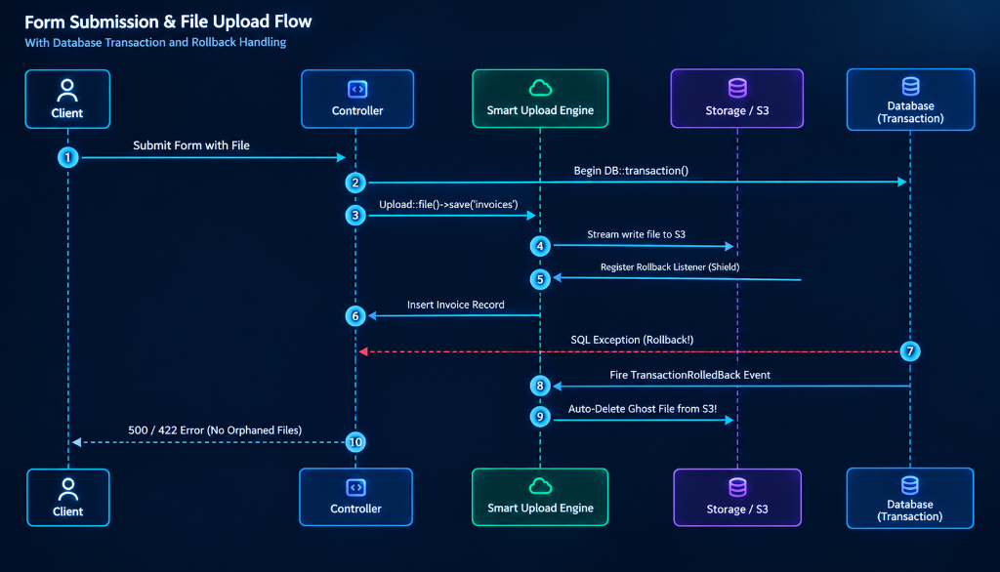

# Layer 3: Atomic Database Rollback Shield

### The Ghost File Problem in Cloud Storage

In traditional Laravel code:

```php
DB::transaction(function () use ($request) {
    // 1. File uploaded to S3
    $path = $request->file('avatar')->store('avatars', 's3');

    // 2. Database query fails! (e.g. QueryException / validation)
    User::create([...]); // Throws exception!
});
```

When an exception occurs, the database transaction rolls back, but **the uploaded file stays on S3 forever**! Over months, this accumulates thousands of orphaned "ghost files", inflating cloud storage bills.

---

### How Smart Upload Solves It



Smart Upload inspects `DB::transactionLevel()`. When an upload occurs inside an active transaction:

1. It registers an automatic rollback safety hook (`TransactionShield`).
2. If the transaction completes successfully, the file remains.
3. If the transaction rolls back or throws an exception, the uploaded file is **automatically deleted from S3 or local disk**!

```php
DB::transaction(function () use ($request) {
    // Protected by TransactionShield:
    $result = Upload::request($request, 'avatar')->save('avatars');

    // If this throws an exception, $result->path is purged from S3 automatically:
    throw new \Exception('Database write failed!');
});
```
Zero ghost files, zero manual cleanup.

