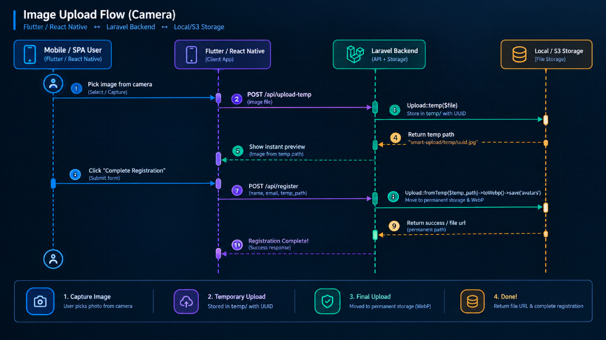

# Layer 5: Mobile & SPA Two-Step Upload Engine

The Two-Step upload architecture decouples binary file transfer from business domain logic, perfectly optimized for mobile apps (Flutter, React Native) and modern SPAs (React, Vue, Inertia).



---

### Step 1: Background Upload (`Upload::temp()`)

When the user picks an image in the UI, the frontend immediately uploads it to temporary storage in the background:

```php
// POST /api/upload-temp
public function uploadTemp(Request $request)
{
    $request->validate(['file' => 'required|file']);

    $result = Upload::temp($request->file('file'));

    return response()->json([
        'token'    => $result->filename, // UUID string
        'temp_url' => $result->url,
    ]);
}
```

The frontend stores this token string in state or a hidden form field.

---

### Step 2: Final Form Submission (`Upload::fromTemp()`)

When the user finishes filling the form and submits, no heavy files are sent—only lightweight JSON:

```php
// POST /api/register (Pure JSON request)
public function register(Request $request)
{
    $validated = $request->validate([
        'name'         => 'required|string',
        'email'        => 'required|email|unique:users',
        'avatar_token' => 'required|string', // Validated as string!
    ]);

    // Promote the temporary file to permanent storage:
    $avatar = Upload::fromTemp($validated['avatar_token'])
        ->preset('avatar')
        ->save('avatars');

    User::create([
        'name'   => $validated['name'],
        'email'  => $validated['email'],
        'avatar' => $avatar->path,
    ]);

    return response()->json(['message' => 'Profile created in < 20ms!']);
}
```

